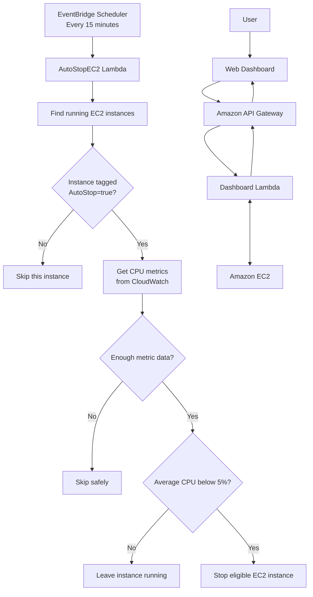

# AWS Automated Cost Optimizer

A serverless AWS project that helps reduce unnecessary EC2 costs by monitoring CPU utilization and stopping eligible low-CPU instances. A web dashboard lets users view EC2 instances and manually start or stop them.

## Workflow Diagram

### Workflow explanation

- **Automatic optimization:** EventBridge Scheduler starts `AutoStopEC2` every 15 minutes. Lambda checks the `AutoStop=true` tag, reads CloudWatch CPU metrics, and stops an instance only when enough data is available and average CPU is below 5%.
- **Dashboard management:** A user sends a request from the web dashboard. API Gateway routes it to the dashboard Lambda, which reads EC2 information or performs a requested start/stop action.

## Project Overview

The AWS Automated Cost Optimizer uses scheduled serverless automation to identify eligible EC2 instances with low CPU utilization and stop them to help reduce unnecessary compute costs.

## AWS Services Used

- **Amazon EC2** — Instances whose state and tags are managed.
- **Amazon API Gateway** — Provides API endpoints for dashboard requests.
- **AWS Lambda** — Handles dashboard actions and scheduled CPU checks.
- **Amazon EventBridge Scheduler** — Triggers the automatic check every 15 minutes.
- **Amazon CloudWatch** — Provides EC2 CPU utilization metrics.

## How It Works

1. EventBridge Scheduler invokes the `AutoStopEC2` Lambda function every 15 minutes.
2. Lambda checks running EC2 instances tagged `AutoStop=true`.
3. Lambda retrieves recent CPU utilization metrics from CloudWatch.
4. If sufficient metrics exist and average CPU utilization is below **5%**, Lambda requests that the eligible instance be stopped.
5. If metrics are insufficient, or CPU is not below the threshold, the instance is skipped or left running.
6. Users can view instance details and request start/stop actions through the web dashboard, using API Gateway and Lambda.

## Dashboard Features

- Metric cards for total, running, stopped, and AutoStop-enabled instances.
- EC2 instance details table.
- Search and filter.
- Refresh instance data.
- Start and stop controls.
- Status messages for actions and errors.

## Prerequisites

- An AWS account.
- EC2 instances that are safe to stop automatically, tagged `AutoStop=true`.
- Lambda execution roles with appropriate permissions to describe instances, read CloudWatch metrics, and start/stop instances.
- A deployed API Gateway endpoint and a dashboard configured to call it.
- EventBridge Scheduler configured to invoke the scheduled Lambda function.

## Important Notes

- Test the automation with a non-critical instance first.
- Stopping an instance can interrupt workloads. Use `AutoStop=true` only for instances that are safe to stop.
- Confirm the CPU metric lookback window, period, and datapoint requirements in the actual Lambda code.
- Actual behavior depends on the deployed code, IAM permissions, and AWS configuration.
## 📸 Project Screenshots

### 1. Screenshot 1

### 2. Screenshot 2

### 3. Screenshot 3

### 4. Screenshot 4

### 5. Screenshot 5

### 6. Screenshot 6

### 7. Screenshot 7

### 8. Screenshot 8

This screenshot shows the `AutoStopEC2` Lambda execution logs and stop requests for eligible EC2 instances based on low CPU utilization.

## Author
Created by: Bhimashankar Ram Dhumal

AWS Automated Cost Optimizer — a learning project focused on AWS serverless application development and EC2 cost optimization.

